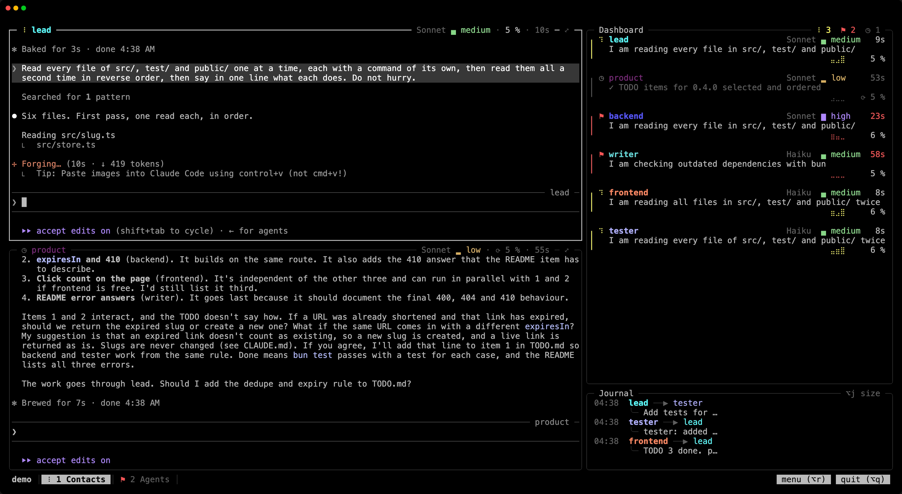
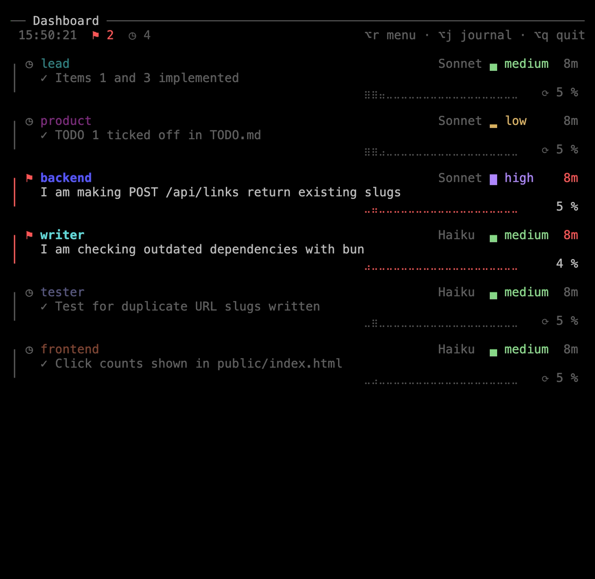
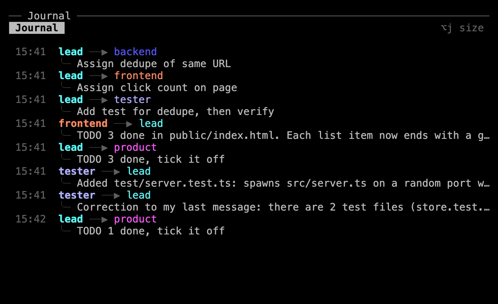

Le tableau de bord te dit d'un coup d'œil qui travaille, sur quoi, et qui t'attend. Le journal montre ce que les membres se disent. Tu sais où en sont les choses sans rien demander à personne.

Les deux sont à droite de tes interlocuteurs, dans le premier onglet : le **tableau de bord** en haut, le **journal** en dessous. Ils lisent ce que Claude Code enregistre déjà, sa liste de sessions (`claude agents --json`) et les fichiers de conversation.

## Le tableau de bord

Le bord du haut de son cadre compte les membres de chaque état ; les raccourcis sont dans la barre, en bas de l'écran. Dessous, une carte par membre.

Ce que tu tapes dans le tableau de bord ou le journal ne fait rien. Le tableau de bord se redessine en entier toutes les 30 secondes et quand l'ordinateur sort de veille ; `Ctrl-L`, dans son panneau, le redessine aussitôt.

### Une carte

Un trait à gauche de la carte prend la couleur de l'état du membre, et le nom le dit aussi :

| État | Trait | Nom |
|---|---|---|
| Au travail | jaune vif | en gras, avec un indicateur animé à sa gauche |
| T'attend dans son terminal (une permission, une question) | rouge vif | en gras, avec l'icône de l'état à sa gauche, et le temps en rouge |
| Au repos | gris | atténué, avec l'icône de l'état à sa gauche |
| Au repos, pendant qu'une commande qu'il a lancée tourne encore (un serveur, une surveillance de fichiers) | gris | atténué, avec un signe de terminal à sa gauche (❯, ou une icône de console là où le terminal a les symboles Nerd Font) |

Claude Code compte comme occupé un membre dont une commande tourne encore après la fin de son tour. Son tour est pourtant fini : le tableau de bord le montre au repos, sous ce signe ; s'il se remet au travail, il repasse au travail.

La carte montre aussi depuis combien de temps le membre est dans cet état (12s, 22m, 1h05), une courbe de son activité sur la dernière demi-heure et, dans son titre, son modèle et son effort, autant que la place le permet : « Opus ◉ extra », sinon « Opus ◉ », sinon « O ◉ », l'initiale du modèle. Le modèle est toujours atténué. L'effort est toujours vif, avec les signes et les couleurs que Claude Code montre sous sa saisie : ○ faible en jaune, ◐ moyen en vert, ● élevé et ◉ extra (le `xhigh` des fichiers) en violet, ◈ max en arc-en-ciel. Sans le mod, ce sont ceux que fixe le fichier de l'équipe, s'il les fixe.

Avec [le mod de recruit](/recruit/fr/guides/claude-code/#le-mod-de-recruit), chargé avec Claude Code 2.1.287 ou plus récent, les cartes en montrent plus :

- **Le modèle et l'effort** qu'utilise vraiment la session du membre.
- **Le contexte**, qui passe en orange à 80 % du seuil où Claude Code compacte de lui-même la conversation du membre, et en rouge à son avertissement, 20 000 jetons avant ce seuil.
- **Ce qu'il fait** : une ligne qui résume la demande en cours du membre, celle que tu lui as tapée ou le message d'un coéquipier. Trop long, le résumé passe sur deux lignes s'il y a la place, sinon il est coupé. Au repos, la ligne montre la dernière tâche, sous sa forme finie (« ✓ Version 2.4.1 publiée »). Un message qui ne demande rien (un merci, un accord) garde la ligne d'avant.
- **L'usage** de ton compte en bas : sur 5 heures et sur 7 jours, avec le temps restant avant chaque remise à zéro.

:::note[Ce que coûtent les résumés]
Haiku écrit les deux formes de la ligne dans le même appel, une fois par nouvelle demande, par la session du membre et donc sur ton compte : la demande lue jusqu'à 2 000 caractères, deux lignes en retour.
:::

Un membre dont le tour a raté sur une erreur d'API le montre sur sa carte, en orange : « Tour raté : API surchargée (529) », puis la tâche où il s'est arrêté. Voir [Quand un tour rate](/recruit/fr/guides/screen/#quand-un-tour-rate).

### Sous-agents et teammates

Quand des membres confient une partie de leur travail à des agents à eux, ceux-ci ont aussi leurs cartes, avec [le mod de recruit](/recruit/fr/guides/claude-code/#le-mod-de-recruit), en bas, après tous les membres, chaque sorte dans sa section sous un filet titré : « ♙ teammates · 3 », puis « ⧗ sous-agents · 2 » tout en bas.

- **Un teammate**, un agent d'une équipe Claude Code lancée par un membre : son nom, et à droite le membre qui l'a lancé, atténué à sa couleur (« ♙ dev-interface »). Jaune au travail, atténué quand il attend un message. La carte reste tant que la session du membre liste le teammate. Un teammate dont l'état n'a pas changé depuis une demi-heure affiche `?` : son panneau est peut-être mort. Au bout de deux heures, il disparaît.
- **Un sous-agent**, lancé par un membre pour une tâche : son type, ce qu'on lui a demandé, depuis combien de temps il travaille, et le membre qui l'a lancé (« ⧗ dev-interface »). Une fois fini, il passe en ✓ atténué une dizaine de secondes, puis disparaît. Un sous-agent lancé par un sous-agent a aussi sa carte.

Un échec s'affiche en orange. Un clic sur une carte mène au panneau du membre qui l'a lancé.

Ils n'ont que la place qui reste une fois que chaque membre a sa carte : ils ne raccourcissent jamais celle d'un membre. Faute de place, une section devient une liste de noms, puis un compte (« ♙ 3 teammates »), les sous-agents cédant avant les teammates. Le [menu de l'équipe](/recruit/fr/guides/menu/) ne les montre pas : il n'y a rien à y régler.

### Compacter une conversation

Un clic sur le contexte d'un membre au repos, marqué ⟳, propose de compacter sa conversation, après confirmation. Le même ⟳ s'affiche dans le bord du haut du cadre du membre. C'est ce que Claude Code ferait de lui-même au seuil, et cela coûte autant : le modèle du membre relit tout son contexte pour le résumer. Un membre qui s'est remis au travail entre-temps refuse. Ensuite, jusqu'à la réponse suivante du membre, la carte montre le contexte tel que Claude Code le compte, comme `/context`.

### Compaction automatique

Un membre qui reste au repos 15 minutes avec un gros contexte est compacté de lui-même, pour qu'il revienne au travail avec de la place, sans attendre que Claude Code le compacte au milieu d'une tâche. Par défaut, à partir de 70 % de sa fenêtre, le chiffre que montrent son cadre et sa carte. Le résumé garde en détail le dernier travail : les fichiers touchés et pourquoi, les choix faits, ce qui reste ouvert, qui a demandé quoi et ce qui a été promis.

Ça ne se fait jamais pour un membre à ton écran, ni pour un membre qui t'attend, dont le tour a raté, dont une commande tourne encore, ou dont des sous-agents ou des teammates travaillent (redemandé cinq minutes plus tard). Une fois au plus par période de repos. Les interlocuteurs sont compactés aussi, quand ils sont hors de vue. Pendant la compaction, le membre reste au repos au tableau de bord.

Chaque compaction laisse une trace : un ⟳ dans la courbe du membre, à l'heure où elle a eu lieu, et une ligne au journal, « ⟳ dev-interface compacté auto · 74 → 9 % », le contexte avant et après. Une compaction que tu demandes, d'un clic ou en tapant `/compact`, laisse la même ligne, sans « auto ». Une compaction automatique ratée laisse une ligne en orange, avec la raison.

`auto_compact = 80` dans les [réglages de l'équipe](/recruit/fr/reference/configuration/#équipes) fixe une autre part, `auto_compact = false` la désactive ; « Compaction auto » dans le [menu de l'équipe](/recruit/fr/guides/menu/#les-actions-déquipe) aussi. Chaque compaction coûte autant qu'une compaction demandée à la main.

### Ordre et place

Les cartes viennent dans cet ordre : les interlocuteurs, les agents qui t'attendent, ceux au travail, puis ceux au repos, du plus récent au plus ancien. Dans cet ordre, chaque carte prend la forme la plus riche que la place lui laisse, une fois que les cartes suivantes ont leur forme la plus sobre :

- sur toute la largeur du panneau, avec ce qu'il fait sur deux lignes, ou sur une ;
- côte à côte avec une autre carte, avec une ligne ou aucune ;
- pour un agent de travail au repos, son seul nom, dans une liste sous les cartes.

Les agents au travail gardent toute la largeur et toute leur tâche tant que les autres peuvent faire de la place : ceux qui sont au repos depuis le plus longtemps passent les premiers dans la liste, et la liste se réduit à une ligne (« … et 3 autres ») avant qu'un agent au travail perde quoi que ce soit de sa tâche. Les sous-agents et les teammates passent en dernier : ils ne prennent que la place que laissent les cartes et les noms, listés, puis comptés, puis plus du tout. La disposition ne change qu'avec les cartes, leurs états ou le panneau.

Quand des sessions ouvertes ailleurs portent le nom de membres, une ligne atténuée, au-dessus de l'usage, les nomme, s'il reste de la place.

## Le journal

Le journal liste les messages que les membres s'envoient, sur deux lignes chacun, et les compactions des membres, sur une ligne chacune.

Il a trois tailles : complet (la moitié de la colonne), réduit (ses trois derniers messages, le reste de la colonne au tableau de bord) et masqué. Il est réduit au lancement. `Alt+j` (`⌥j` sous macOS) le fait passer de complet à réduit, puis à masqué, puis de nouveau à complet. `/equipe` (`/team` dans une équipe en anglais), tapé dans l'invite d'un membre, fait de même, même quand Claude travaille.

## Clics

Un clic sur la carte d'un membre, sur son nom dans la liste, ou sur l'expéditeur ou le destinataire d'un message du journal, mène au panneau de ce membre, dans son onglet.

## Sans eux

`dashboard = false` dans les réglages de l'équipe, ou « Tableau de bord » dans le [menu de l'équipe](/recruit/fr/guides/menu/), se passe des deux : les interlocuteurs sont alors côte à côte dans le premier onglet. Avec `layout = "tabs"`, les deux vont dans le premier onglet.

Un tableau de bord fermé par erreur revient quand tu relances `recruit` sur l'équipe qui tourne.
