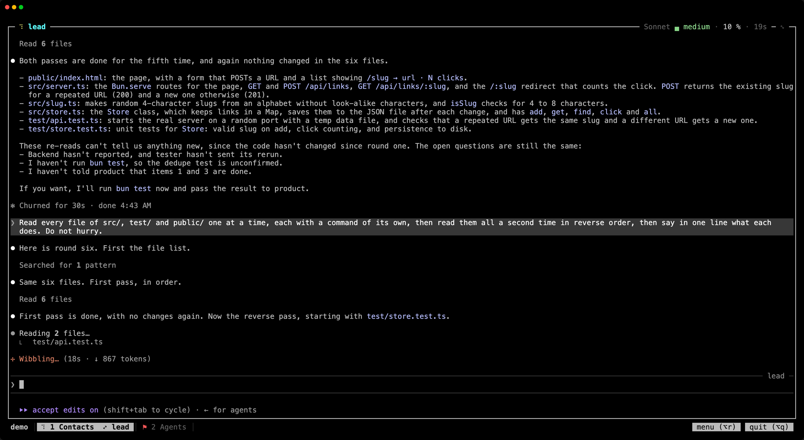
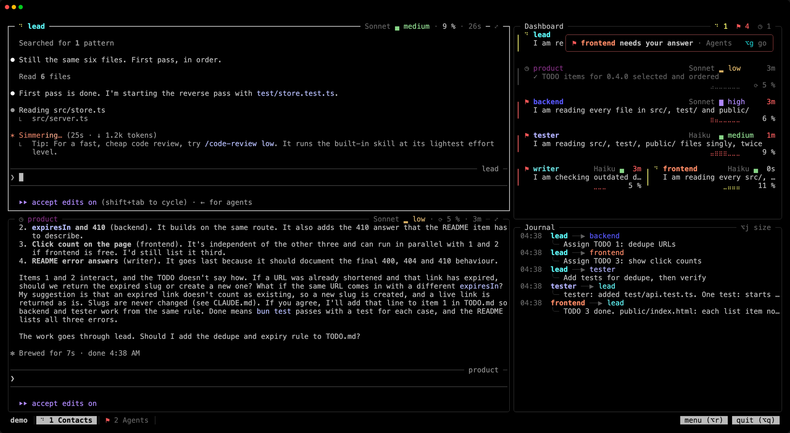

Your team keeps working when you leave. Close the terminal, come back tomorrow, from another machine if you like: everyone is where you left them. This page shows how to read the screen, move around it, and leave and come back.

## Leave and come back

`⌥q`, or the "quit" button at the bottom right, offers three things: Detach (`d`), Quit (`q`, which stops the team) and Cancel (`c`). Detached, the team keeps working. Closing the terminal, even with `Cmd+q`, closes the window, not the team.

To come back, from any terminal:

```sh
recruit            # in the project: joins the running team
recruit attach     # the project's team, or the only one running
recruit attach web # a given team
recruit list       # the teams, and which ones are running
```

**Over SSH**, it works the same way: launch the team in an SSH session, close it, reconnect later and run `recruit attach`. The team runs on that machine all along.

A second terminal that joins the team takes it over: the first one is detached, and says so.

Running `recruit` again on a running team also starts again the members that no longer run, and reopens a closed dashboard. If members are missing from the screen, it offers to build the team again, each member resuming its conversation. If the team stopped unexpectedly (a crash, the machine restarted), `recruit` starts it again, each member resuming its conversation, and tells you; a second time within ten minutes, it asks first.

## Stop

`⌥q` then "Quit" (`q`), "Quit" in the team's menu, or from a shell:

```sh
recruit stop       # asks first
recruit stop -y    # does not ask
```

Every member's Claude session is closed. `recruit --resume` later picks up each member's last conversation.

## Each member's frame


Each member works in its own frame. The one you type in is thick, in your terminal's text color; the others are thin and grey. A red frame needs you: a member waiting for your answer, or one whose screen has failed (the reason shows next to its name).

The top border tells you about the member, from left to right:

- its state: a spinner while it works, ⚑ when it waits for you, ◷ at rest, ❯ when a command it started still runs;
- its name, in its color, the same as on the dashboard and in the journal;
- on the right, its model, its effort, its context and the time in its state, for example `Opus ● high · 29 % · 6m`. The effort's sign says its level as under Claude Code's prompt: ○ low, ◐ medium, ● high, ◉ extra, ◈ max. The context turns orange as the conversation nears its automatic compaction, red at Claude Code's warning;
- ⤢ in the corner.

In a narrow frame, the details go first: the effort's word, then the model's name gives way to its initial (O, S, H, F), then the time, the initial, the effort's sign and the context. Frames of the same width show the same details, in columns.

What a click does:

| Click on | Does |
|---|---|
| a member's name | opens its sheet in the [team's menu](/recruit/guides/menu/) |
| its model or its effort | opens the list of its values right under it |
| ⟳ before the context of a member at rest | offers to compact its conversation, after confirmation |
| ⤢ | shows this member over the whole tab; ⤡ brings the others back |
| anywhere in a frame | puts you there |

Under the pointer, a name is underlined and "settings ›" shows next to it.

### Model and effort in one click

The list under the model or the effort starts with "default: …", what the member gets when nothing sets it, with where it comes from ("default: high (settings.toml)", or "(Claude Code)"). "current" marks the value in place, and ↻ a value that will start the member again on its conversation, because its requests cannot carry it. Pick one with the arrows and `⏎`, or click it: it is written in the team's files, as from the [menu](/recruit/guides/menu/#where-changes-are-written), and reaches the member at once. When the member is at work and the value would start it again, the list asks first, on "Cancel". `Esc`, a click outside or a second click on the text close it.

## When a turn fails

When a member's turn ends on an API error (an overloaded API, a lost connection), its frame turns orange and its top border gives a short reason after its name, such as "API overloaded (529)". Its tab shows ✗, after ⚑ when someone also waits there. Out of sight, a notice in orange tells you, and `⌥g` goes there after the members waiting for you. The member stays so until its next turn. "Resume" on its sheet in the [team's menu](/recruit/guides/menu/) sends it "continue", unless its prompt holds text you were typing.



## The bar

The bottom row holds the team's name, its tabs and two buttons. The current tab is highlighted. Each tab shows the state of its busiest member: a spinner while someone works there, ⚑ when someone waits for you. When a member is shown full screen, its tab says so: `2 Agents (1)  ⤢ dev-saisie`.

On the right, "focus (⌥l)" or "grid (⌥l)" switches the layout of the current tab (see [Focus](/recruit/guides/contacts-and-agents/#focus)), "menu" opens the [team's menu](/recruit/guides/menu/) and "quit" offers to detach or quit. In a narrow window, the other tabs keep only their number and the buttons only their key.

## Light or dark

recruit's own colors (the members', the efforts', the highlighted lines and buttons) follow your terminal's background: a light set on a light background, the dark one otherwise. Your terminal's own colors stay its own. The members' programs are told the theme too, when they ask for it.

## When a member needs you



When a member you cannot see starts waiting for your answer, a notice shows at the top right for six seconds: "dev-saisie needs your answer", with its tab. Click it, or press `⌥g`, to go there. Its tab keeps ⚑ until you answer.

`⌥g` always goes to the member that has waited the longest.

Your terminal still gets what Claude Code sends it: its notifications, its progress bar and the window's title.

## Select and copy

What you select goes to your clipboard. Drag across the text; double-click takes a word, triple-click a line. The selection stays highlighted until your next click or key. In a program that takes the mouse, such as Claude Code in full screen, hold Shift while you drag.

The copy goes through your terminal, as Claude Code's own `/copy` does. Ghostty, kitty and WezTerm take it as is. iTerm2 asks you to allow it once: Settings › General › Selection › "Applications in terminal may access clipboard". Terminal.app cannot take it: there, hold Fn while you drag, then `Cmd+c`. That is Terminal's own selection, which copies the screen as shown, frames included.

Over SSH, the copy reaches the clipboard of the machine you type on.

## History

Each member keeps its history. Where its program does not take the mouse, the wheel scrolls back through it; `Shift+Page Up` and `Shift+Page Down` too, a page at a time, and `Shift+Home`, `Shift+End` go to its oldest line and back to the live screen. The top border says how far up you are (`↑ 214 of 3000`). Typing in the frame brings you back to the live screen.

## Keys

`⌥` is the Option key on macOS, Alt elsewhere: the screen shows the keys as they are on your system. There is no prefix: every other key, `Ctrl-b` included, goes to Claude Code.

| Key | Does |
|---|---|
| `⌥1`…`⌥9` | go to a tab |
| `⌥⇧←` / `⌥⇧→` | previous / next tab |
| `⌥n` | next member of the tab; in a tab in focus, it comes to the left; shown over the whole tab, it takes the place |
| `⌥z` | this member over the whole tab, and back |
| `⌥l` | the current tab in [focus](/recruit/guides/contacts-and-agents/#focus), or back to its grid, until you detach |
| `⌥g` | go to the member waiting for you, else to one whose turn failed |
| `⌥j` | journal full, reduced, then hidden (or `/team`, `/equipe` in a French team, in a member's prompt) |
| `⌥r` | the [team's menu](/recruit/guides/menu/), on the sheet of the member you are in (or `/recruit` in a member's prompt) |
| `⌥q` | detach, quit or cancel |
| `Shift+Page Up` / `Shift+Page Down` | scroll a member's history |
| `Shift+Home` / `Shift+End` | its oldest line / back to the live screen |

`Shift+Enter` inserts a new line in Claude Code, in any terminal.

## Option on macOS

On macOS, Alt is the Option key: recruit writes it ⌥ in the bar, the dashboard and the journal (⌥j, ⌥q, ⌥r).

The terminal has to send Option as Alt. Otherwise Option+letter types a special or accented character, depending on the keyboard layout, and recruit sees no shortcut.

| Terminal | Setting |
|---|---|
| Ghostty | `macos-option-as-alt = left` (or `right`, or `true`) in its configuration. Ghostty only does it by default for U.S. layouts. |
| Terminal.app | Profiles › Keyboard › Use Option as Meta Key |
| iTerm2 | Profiles › Keys, left Option key set to "Esc+" |
| kitty | `macos_option_as_alt left` (or `right`, or `yes`) in `kitty.conf` |
| WezTerm | Nothing for the left Option key, which sends Alt by default (`send_composed_key_when_left_alt_is_pressed = false`) |

Meanwhile, the "menu" and "quit" buttons, and `/recruit` and `/team` in a member's prompt, do the same.
